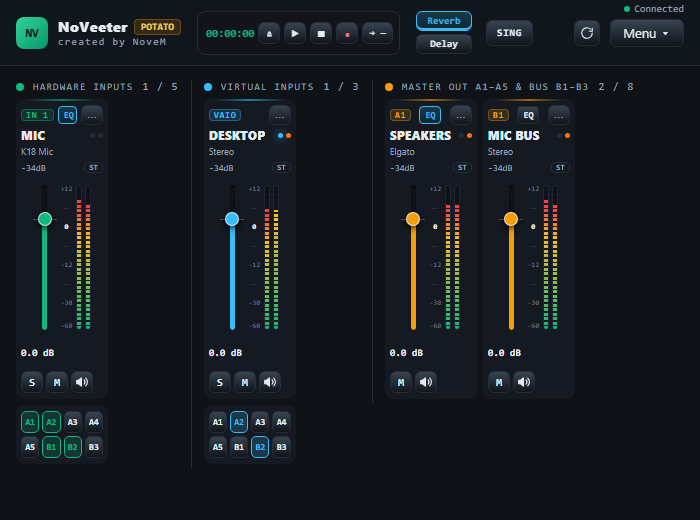
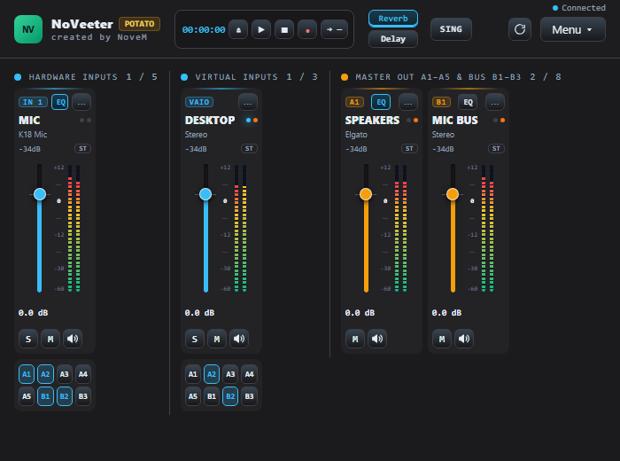
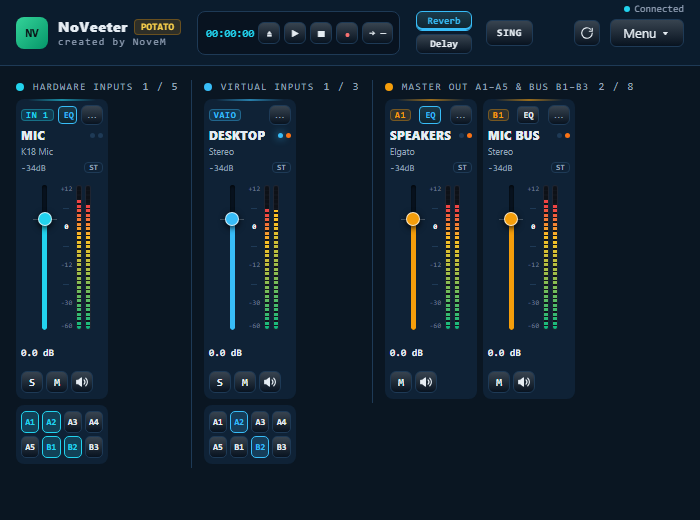
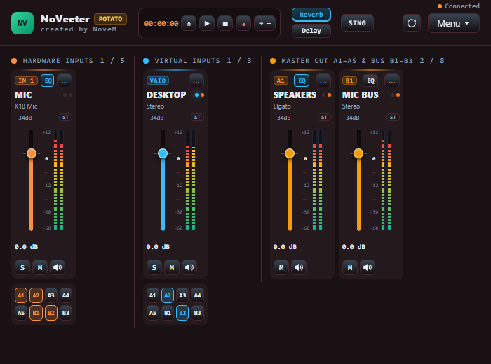
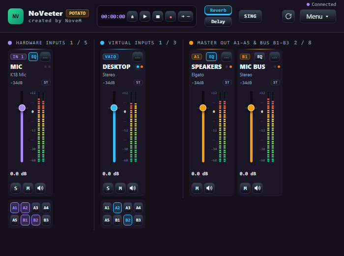
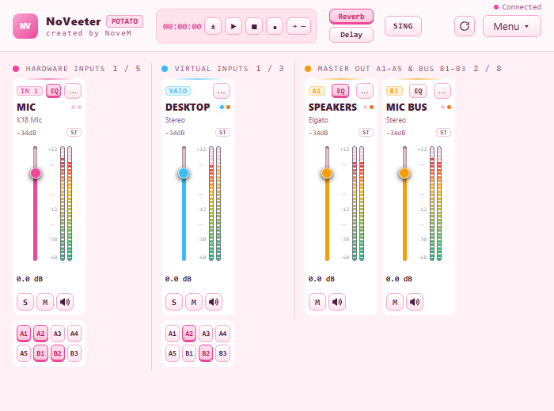
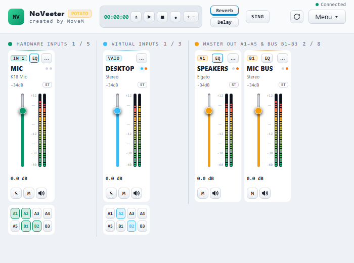

# NoVeeter

A compact, themeable desktop control surface for **Voicemeeter Potato**, built with [Tauri 2](https://tauri.app/) (Rust) and React + TypeScript.

NoVeeter talks to a running Voicemeeter Potato through the official Voicemeeter Remote API. It is a flat, space-efficient alternative to the stock UI: every strip, module and button can be shown or hidden, and the layout shrinks with the window.

> **Unofficial.** NoVeeter is not affiliated with or endorsed by VB-Audio. Voicemeeter is a trademark of VB-Audio Software.

## Download

Grab the latest portable build from the [Releases page](../../releases/latest):

1. Download `NoVeeter-windows-x64.zip` (or `NoVeeter.exe` directly).
2. Unzip and run `NoVeeter.exe`. No installer needed.
3. Make sure Voicemeeter Potato is installed. NoVeeter starts it if it is not running.

Settings are saved in `layout-config.json` next to the executable, so keep the exe in a folder you can write to.

> Windows may show a SmartScreen warning because the executable is unsigned. Choose **More info → Run anyway**.

## Screenshots

Seven built-in themes, switchable from **Menu → Theme**.

<p align="center">
  
  
  
</p>
<p align="center">
  
  
  
</p>
<p align="center">
  
</p>

Order: Midnight (default), Graphite, Ocean, Sunset, Violet, Blossom, Light.

Screenshots use fake mixer data and show one strip of each kind (IN 1, VAIO, A1, B1). To regenerate them, run `npm run dev` and open `http://127.0.0.1:1420/?demo&theme=ocean` in a browser (add `&keep=0,1,5,8,13` to choose which channels show). The demo mode only exists outside the desktop app.

## Features

**Mixer**
- All 16 Potato channels: 5 hardware inputs, 3 virtual inputs (VAIO, AUX, VAIO 3) and 8 outputs/buses (A1–A5, B1–B3).
- Gain fader (-60 to +12 dB) with wheel, keyboard and double-click-to-reset; double-click the dB readout to type an exact value.
- Stereo LED meters with fast attack and slow release.
- Mute with a short fade out / fade in (mute click is smoothed, the fader returns to its original level).
- Solo, mono / reverse, and per-input A1–B3 routing (also shown as a quick routing card under each strip when there is room).

**Per-channel detail (modal)**
- Intellipan pad with **Color**, **FX** and **Pan** modes (hardware inputs).
- Audibility (Gate, Comp, Denoiser) and FX sends as compact numeric fields.
- 3-band EQ for virtual inputs.
- 6-band parametric EQ for hardware inputs and all buses, with a **Bar** view and a **Field** view. Right-click the `EQ` chip on a card to open it, click it to toggle EQ on/off.

**Top bar**
- **Cassette recorder:** play, stop, record, open a music file, playback output bus picker (A1–B3, multi-select) and a smooth seek timeline. After a recording finishes, the new file is loaded automatically.
- **Reverb / Delay** master FX buttons (click: on/off, right-click: panel with preset and return level).
- **SING:** keeps your mic balanced against music by nudging the mic gain (within a configurable range) so the voice sits above the music. Music is never touched.
- **Restart audio engine** button and a floating connection status.

**Layout and look**
- Show / Hide dialog for sections, modules (Intellipan, Audibility, FX Sends, Solo, Mono, Recorder, Reverb, Delay, SING) and individual channels.
- Responsive card height: strips shrink with the window, including when groups wrap onto several rows.
- Named layout presets, window size and always-on-top remembered.
- Themes: Midnight, Graphite, Ocean, Sunset, Violet, Blossom, Light.
- Right-click menu is disabled; click outside any dialog to close it.

## Requirements

- Windows 10/11 (Voicemeeter and the Remote API are Windows-only).
- [Voicemeeter Potato](https://vb-audio.com/Voicemeeter/potato.htm) installed. NoVeeter launches it if it is not running.
- For development: [Node.js](https://nodejs.org/) 20+, [Rust](https://rustup.rs/) (stable) and the [WebView2 runtime](https://developer.microsoft.com/microsoft-edge/webview2/) (already present on Windows 11).

## Getting started

```bash
npm install
npm run tauri dev
```

`npm run dev` starts the web UI alone in a browser as a preview. Audio controls only work in the desktop app.

### Build a portable executable

```bash
npm run portable
```

This runs `tauri build --no-bundle` and produces a single `.exe` in `src-tauri/target/release/`, with no installer. Settings are stored next to the executable in `layout-config.json`.

### Publish a release

Releases are built by GitHub Actions ([release.yml](.github/workflows/release.yml)). Push a version tag and the workflow builds the portable exe and attaches it to a new GitHub Release:

```bash
git tag v0.1.0
git push origin v0.1.0
```

The workflow can also be run manually (Actions tab → Release → Run workflow); that uploads the exe as a build artifact instead of a release.

### Scripts

| Command | What it does |
| --- | --- |
| `npm run tauri dev` | Run the desktop app with hot reload |
| `npm run dev` | Browser-only UI preview |
| `npm run build` | Type-check and build the web UI |
| `npm test` | Run the layout parser tests |
| `npm run portable` | Build the portable `.exe` |

Rust tests: `cd src-tauri && cargo test`.

## Project structure

```
src/
  main.tsx        React UI (strips, dialogs, recorder, FX, SING, themes)
  layout.ts       Layout/preset schema, validation and theme list
  layout.test.ts  Tests for the layout parser
  style.css       Styles and theme variables
src-tauri/
  src/main.rs     Tauri commands: layout load/save, command registration
  src/mixer.rs    Voicemeeter Remote worker thread, parameter validation, recorder, FX
```

How it works: a single worker thread owns the Voicemeeter Remote connection (the DLL requires level and parameter calls to stay on one thread). It polls parameters and meter levels and pushes snapshots to the UI; UI actions go back through validated Tauri commands.

## Settings file

`layout-config.json` (next to the executable) stores presets, visibility, window size, theme and SING settings. It is validated on load. An unreadable file is left untouched and reported in the UI rather than overwritten. The file is git-ignored.

## Known limitations

- The recorder position/timeline is tracked locally from your clicks (the Remote API exposes no tape position), so it can drift if you control the cassette inside Voicemeeter at the same time.
- The recorder folder for auto-loading finished takes is `Documents\Voicemeeter`.
- Parametric EQ edits the first audio lane (`channel[0]`).
- Virtual inputs have no parametric EQ in Potato; they use the 3-band EQ.
- Only Voicemeeter **Potato** is supported (not Standard or Banana).

## Contributing

Issues and pull requests are welcome. Please keep changes small, run `npm run build`, `npm test` and `cargo test` before submitting.

## License

Released under the [MIT License](LICENSE).
